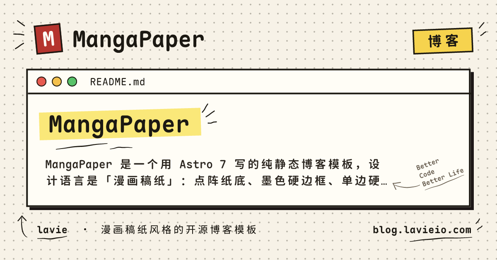
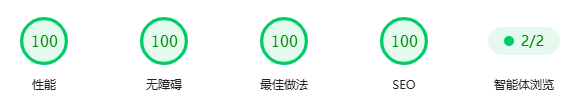

# MangaPaper 🖋




**简体中文** · [English](README.en.md)

MangaPaper 是一个漫画稿纸风格的开源博客模板。点阵纸背景、墨色硬边框、偏移硬阴影与贴纸式标签构成它的视觉语言，搭配自托管等宽字体和明暗主题。

项目基于 Astro 生成纯静态站点，无需自建应用服务器。你可以直接用 Markdown 写作，并按需启用私密文章、评论、访问统计和搜索引擎验证。

[在线示例](https://blog.lavieio.com) · [使用此模板](https://github.com/lavieio/manga-paper-template/generate) · [反馈问题](https://github.com/lavieio/manga-paper-template/issues)

## ✨ 功能亮点

- **漫画稿纸风格**：点阵背景、硬边框、单向硬阴影、贴纸标签，以及明暗双主题。
- **自托管字体**：使用 Maple Mono NF CN；构建时按站点内容生成字体子集，无需依赖第三方字体 CDN。
- **完整的内容组织**：精选文章、分类、标签、归档时间轴、草稿与分页（每页默认 8 篇）。
- **阅读体验优化**：文章目录与滚动高亮、代码一键复制、PhotoSwipe 图片灯箱，以及构建期图片尺寸处理以减少布局偏移。
- **静态全文搜索**：集成 Pagefind，构建时生成索引，支持中文检索。
- **SEO 与分享**：生成 sitemap、RSS、robots.txt，并为公开文章生成 1200 × 630 OG 分享图；草稿与私密文章不会进入公开索引或生成分享图。
- **私密文章**：构建时使用 AES-256-GCM 加密，静态站点只发布密文；访客在 `/private` 页面输入密码后，由浏览器解密内容。
- **按需启用的集成**：remark42 评论、Google Analytics 4、Google Search Console 验证，以及 Vercel Web Analytics / Speed Insights。
- **静态托管友好**：支持 Vercel 和 Cloudflare Pages，并根据环境变量生成相应的部署配置与安全响应头。

## 🚀 快速开始

**环境要求：Node.js `>=22 <25`。**

### 1. 创建仓库并克隆项目

推荐使用 [Use this template](https://github.com/lavieio/manga-paper-template/generate) 创建自己的仓库，再克隆新仓库到本地。若计划发布私密文章，请将仓库设为 **Private**。

```bash
git clone https://github.com/<your-name>/<your-repo>.git my-blog
cd my-blog
npm install
```

如果你是为了参与主题开发，也可以直接克隆模板仓库：

```bash
git clone https://github.com/lavieio/manga-paper-template.git my-blog
cd my-blog
npm install
```

### 2. 配置环境变量并启动

复制环境变量示例文件：

```bash
cp .env.example .env
```

Windows PowerShell 可使用：

```powershell
Copy-Item .env.example .env
```

编辑 `.env`，将 `SITE_URL` 设置为本地地址：

```dotenv
SITE_URL=http://localhost:4321
```

启动开发服务器：

```bash
npm run dev
```

然后访问 [http://localhost:4321](http://localhost:4321)。开发模式下尚未生成 Pagefind 搜索索引；请使用构建预览测试搜索功能。

> **部署前请务必设置正式的 `SITE_URL`。** 该变量必须是站点根 URL；缺失、格式无效或仍使用示例域名时，`npm run build` 会失败。

## 🎛 站点配置

站名、作者、简介、首页快捷入口和分页设置统一放在仓库根目录的 **`manga-paper.config.ts`** 中。

```ts
import { defineConfig } from "./src/types/config";

export default defineConfig({
  site: {
    name: "MangaPaper",
    tagline: "A loose-leaf, comic-paper, monospace blog theme",
    author: "lavie",
    bio: "漫画稿纸风格的开源博客模板",
  },
  posts: {
    perPage: 8,       // 列表每页篇数
    recentCount: 3,   // 首页「最近更新」条数
  },
  socials: [
    { label: "GitHub", url: "https://github.com/you/repo", icon: "github", primary: true },
    { label: "邮箱", url: "mailto:yourmail@gmail.com", icon: "mail" },
    { label: "微博", url: "https://weibo.com/you", icon: "weibo" },
    { label: "友链", url: "https://example.com", icon: "/icons/friend.svg" },
  ],
});
```

| 配置项 | 作用 |
| --- | --- |
| `site.name` / `site.tagline` | 站点名称与简介，用于页头、页面标题、RSS 和默认分享信息 |
| `site.author` / `site.bio` | 作者与站点简介；也用于关于页描述或默认分享卡片的文案兜底 |
| `posts.perPage` / `posts.recentCount` | 列表分页篇数 / 首页「最近更新」条数 |
| `socials[]` | 首页快捷入口，数组顺序即显示顺序；`primary: true` 用于突出主入口，最多设置一个 |

`socials` 只控制**首页快捷入口条**，不会显示在关于页。RSS 由模板自动追加，无需重复配置；页脚自带 RSS 与私密文章入口。

### 自定义入口图标

`icon` 支持以下三种形式。未填写或无法识别时会回退到通用外链图标：

| 类型 | 示例 | 说明 |
| --- | --- | --- |
| 内置图标 | `icon: "github"` | 使用模板内置的单色图标，颜色跟随主题 |
| 本地图片 | `icon: "/icons/weibo.svg"` | 文件放在 `public/icons/`，支持 SVG、PNG、WebP |
| HTTPS 图片 | `icon: "https://cdn.example.com/x.png"` | 外链图片需使用 HTTPS |

内置图标包括：`github`、`x`、`facebook`、`instagram`、`linkedin`、`telegram`、`youtube`、`reddit`、`discord`、`mastodon`、`bluesky`、`threads`、`rss`、`weibo`、`zhihu`、`bilibili`、`wechat`、`douban`、`juejin`、`gitee`、`mail`、`link`、`seal`。图标路径基于 [Simple Icons](https://github.com/simple-icons/simple-icons)（CC0-1.0），内联维护在 `src/utils/social/icons.ts`，不会额外引入依赖或发起图标请求。

> 部署配置和密码等值应写入 `.env` 或部署平台的环境变量，而不是 `manga-paper.config.ts`。`label` 或 `url` 为空、或 `url` 含空白字符时，构建检查会报告对应入口。

## 🧰 常用命令

在项目根目录执行：

| 命令 | 作用 |
| --- | --- |
| `npm install` | 安装依赖，并安装 Git hooks |
| `npm run dev` | 启动本地开发服务器 |
| `npm run fonts` | 按当前内容生成字体子集；开发与构建流程也会自动调用 |
| `npm run build` | 构建静态站点、字体、分享卡片、部署配置和 Pagefind 索引，输出到 `dist/` |
| `npm run preview` | 本地预览构建产物，可用于测试搜索 |
| `npm run astro ...` | 调用 Astro CLI，例如 `npm run astro add` |

## 📝 编写文章

文章存放在 `src/content/blog/` 下。**一级子目录名就是分类，文件名就是 URL slug**。例如 `src/content/blog/tech/hello-world.md` 会归入 `tech` 分类。

文章使用 Markdown，并通过 frontmatter 设置元信息：

```yaml
---
title: 文章标题
description: 用于 SEO、RSS 和分享卡片的摘要
tags: [技术, 随笔]
featured: true          # 可选：加入首页精选轮播
draft: false            # 可选：true 时不发布
private: false          # 可选：true 时作为私密文章加密
cover: /images/cover.png # 可选：封面图片
---

正文从这里开始。
```

`date` 和 `updated` 通常无需手动维护，Git hooks 会根据提交信息处理：

| 提交信息示例 | 行为 |
| --- | --- |
| `feat(blog): 发布新文章` | 新文章自动写入 `date`；已有文章更新 `updated` |
| `fix(blog): 修正文章错字` | 不刷新 `updated`；`chore` 提交同样如此 |
| 提交信息包含 `[skip-updated]` | 跳过 `updated` 刷新 |

## 📄 自定义关于页

关于页正文位于 `src/content/pages/about.md`。它是内容文件，可使用 Markdown、HTML 和 `<style>`；`src/pages/about.astro` 负责套用页面布局并渲染正文。

```md
---
title: 关于
description: 页面描述；省略时回退到 site.bio
prose: true
stats: true
---

## 我在做什么

- 第一件事
- 第二件事

<div class="intro">
  
  <p>可以使用 HTML 和 CSS 自定义页面版式。</p>
</div>

<style>
.intro { display: grid; grid-template-columns: 170px 1fr; gap: 36px; }
</style>
```

- **Markdown**：使用与文章一致的渲染流程，并应用 `.prose` 排版。
- **HTML**：可用于设计自定义布局。
- **`<style>`**：样式会限定在 `@scope (.about-custom)` 内，避免普通类名影响页头和页脚。
- **`prose`**：默认 `true`，使用模板的文章排版；若要完全自定义 CSS，可设为 `false`。
- **`stats`**：默认 `true`，在正文下方显示构建期统计的文章、分类和标签数量；设为 `false` 可关闭。
- **颜色**：优先使用 `var(--ink)`、`var(--card)`、`var(--red)`、`var(--yellow)` 等主题变量，避免写死颜色导致暗色主题下对比度异常。
- **图片与脚本**：手写 `` 时请提供 `width` 和 `height`；不建议在关于页中添加 `<script>`，因为它不会经过 Astro 的常规打包流程，模板也不保证兼容。

## 🔒 私密文章

1. 在 `.env` 或部署平台环境变量中设置 `PRIVATE_PASSWORD`，部署前将其替换为强密码。
2. 在文章 frontmatter 中设置 `private: true`。
3. 部署后，读者可通过页脚的「私密」入口进入 `/private`，输入密码后在浏览器中解密和阅读内容。

模板使用 PBKDF2（SHA-256，600,000 次迭代）派生密钥，并通过 AES-256-GCM 加密。解锁状态默认保存在浏览器 `localStorage` 中 1 小时，可通过 `PUBLIC_UNLOCK_TTL_HOURS` 调整。

私密文章会从公开文章列表、归档、标签、分类、RSS、sitemap 和搜索索引中排除，相关页面也会标记为 `noindex`。

> **安全提示：** 请将存放真实私密文章的源代码仓库设为 Private。`noindex` 只是搜索引擎提示，不是访问控制；请使用强密码，并妥善保存备份。密码遗失后无法通过模板恢复内容。

## ⚙️ 环境变量

`.env.example` 列出了全部配置项。`.env` 已加入 `.gitignore`，请勿提交密码或其他敏感值。带 `PUBLIC_` 前缀的变量可能会暴露给浏览器端，**不要在其中存放秘密信息**。

| 变量 | 说明 |
| --- | --- |
| `SITE_URL` | **必填。** 站点根 URL，用于 canonical、sitemap 和 RSS；生产构建不能使用示例域名。 |
| `PRIVATE_PASSWORD` | 私密文章密码。默认值 `manga-paper` 仅适合本地预览，上线前必须替换。 |
| `PUBLIC_UNLOCK_TTL_HOURS` | 浏览器记住私密文章解锁状态的时长，单位为小时，默认 `1`。 |
| `SKIP_REMOTE_IMAGE_SIZE` | 可选。设为 `1` 可跳过构建期间的远程图片尺寸探测，适用于离线或无法访问图片源的环境。 |
| `PUBLIC_REMARK42_HOST` / `PUBLIC_REMARK42_SITE_ID` | 可选。两项都配置后才会显示 remark42 评论区。 |
| `PUBLIC_GA_MEASUREMENT_ID` | 可选。GA4 Measurement ID，例如 `G-XXXXXXXXXX`；未配置时不加载 GA4。 |
| `PUBLIC_GSC_VERIFICATION` | 可选。Google Search Console 的 HTML meta 验证值；使用 DNS TXT 验证时不需要。 |
| `PUBLIC_VERCEL_ANALYTICS` | 可选，仅 Vercel。设为 `1` 启用 Web Analytics；还需在 Vercel 项目面板启用该功能。 |
| `PUBLIC_VERCEL_SPEED_INSIGHTS` | 可选，仅 Vercel。设为 `1` 启用 Speed Insights；还需在 Vercel 项目面板启用该功能。 |

### 可选集成

- **remark42**：同时配置 `PUBLIC_REMARK42_HOST` 和 `PUBLIC_REMARK42_SITE_ID` 后启用；评论区只显示在公开文章中。
- **Google Analytics 4**：配置 `PUBLIC_GA_MEASUREMENT_ID` 后启用；只在生产构建且非 `noindex` 页面加载。GA4 可能使用 Cookie，请根据目标地区与适用法规配置访客同意机制。
- **Google Search Console**：可以使用 DNS TXT（通常更方便）或 HTML meta 标记验证。验证后提交 `https://你的域名/sitemap-index.xml`。
- **Vercel Web Analytics / Speed Insights**：仅适用于 Vercel 部署，两个开关可以独立启用。未启用时，模板不会主动加载对应统计脚本。

## 🌐 部署

MangaPaper 输出纯静态文件，构建产物位于 `dist/`。选择 Vercel 或 Cloudflare Pages 部署即可。

### Vercel

可以使用[一键部署入口](https://vercel.com/new/clone?repository-url=https%3A%2F%2Fgithub.com%2Flavieio%2Fmanga-paper-template&project-name=manga-paper&repository-name=manga-paper&env=PRIVATE_PASSWORD,SITE_URL,PUBLIC_UNLOCK_TTL_HOURS&envDescription=PRIVATE_PASSWORD%20encrypts%20private%20posts%20%E2%80%94%20use%20a%20strong%20password%20before%20going%20live.%20SITE_URL%20is%20your%20real%20domain.%20PUBLIC_UNLOCK_TTL_HOURS%20is%20the%20unlock%20memory%20in%20hours%2C%20default%201.&envDefaults=%7B%22PUBLIC_UNLOCK_TTL_HOURS%22%3A%221%22%7D)，也可以在 Vercel 控制台导入自己的仓库。

- Framework Preset：`Astro`
- Build Command：`npm run build`
- Output Directory：`dist`
- Node.js：`22`（或其他受支持的 `>=22 <25` 版本）

请设置正式的 `SITE_URL`；若使用私密文章，还要设置强密码 `PRIVATE_PASSWORD`。

### Cloudflare Pages

1. 在 Cloudflare 控制台进入 **Workers & Pages → Create → Pages → Connect to Git**，选择你的仓库。
2. Build command：`npm run build`。
3. Build output directory：`dist`。
4. 添加环境变量 `NODE_VERSION=22`，并根据需要配置其他环境变量，然后部署。

构建时会为支持的平台生成安全响应头配置，包括 HSTS、`X-Content-Type-Options`、`Referrer-Policy`、`X-Frame-Options`、`Permissions-Policy` 和 CSP。当前 CSP 为 **Report-Only** 模式，只报告策略问题，不会主动拦截资源。

## 🎨 设计与技术

### 设计语言

- **点阵稿纸**：以细小墨点和规则网格营造纸张质感。
- **硬边与硬阴影**：粗墨色边框搭配单方向偏移阴影，不使用模糊效果。
- **贴纸式标签**：略微旋转的彩色标签，让内容像整理在稿纸上的便签。
- **明暗主题**：在两种主题下复用相同的布局结构。

### 项目结构

```text
/
├── assets/fonts/                 # 上游字体文件与许可证
├── public/                       # 静态资源、图标和 README 预览图
├── scripts/                      # 构建检查、字体生成、日期处理和部署配置
├── src/
│   ├── components/               # 文章卡片、目录、评论等组件
│   ├── content/blog/             # 博客文章；一级目录名即分类
│   ├── content/pages/about.md    # 关于页正文
│   ├── layouts/                  # 页面布局
│   ├── pages/                    # 站点路由、RSS 与 OG 分享图
│   ├── plugins/                  # 内容处理插件
│   ├── scripts/                  # 浏览器端交互
│   ├── styles/                   # 全局、文章和组件样式
│   └── utils/                    # 工具，按领域分子目录
│       ├── og/                   # OG 分享卡片：渲染管线与 og:image 取值
│       ├── content/              # 文章内容管线：读取、分类、格式化、阅读时长、结构化数据
│       ├── env/                  # 环境变量、站点地址、统计
│       ├── deploy/               # 安全响应头与 301 策略
│       ├── social/               # 首页入口与内置图标
│       ├── crypto/               # 私密文章加密
│       ├── image/                # 外链图片尺寸探测
│       └── font/                 # 字体子集清单（构建期生成）
├── manga-paper.config.ts         # 站点与首页入口配置
├── astro.config.mjs
└── vercel.ts                     # Vercel 项目配置
```

### 技术栈

- [Astro](https://astro.build/)：静态站点生成
- TypeScript：站点配置与构建脚本
- [Maple Mono NF CN](https://github.com/subframe7536/maple-font)：自托管等宽字体，采用 SIL OFL-1.1 许可证
- [Pagefind](https://pagefind.app/)：静态全文搜索
- [PhotoSwipe](https://photoswipe.com/)：图片灯箱
- [Satori](https://github.com/vercel/satori) 与 [resvg-js](https://github.com/thx/resvg-js)：构建期生成 OG 分享图
- [remark42](https://remark42.com/)：可选评论系统
- Web Crypto API：私密文章加密

## ⚡ 性能

<p align="center">
  <a href="https://pagespeed.web.dev/analysis?url=https%3A%2F%2Flavieio.com%2F&form_factor=desktop">
    
  </a>
</p>

模板重点减少首屏资源负担：字体自托管并按内容生成子集，图片尺寸与 OG 分享图在构建期处理；默认不启用的第三方集成不会主动加载。上方截图记录了一次桌面端 PageSpeed Insights 测试结果，实际分数会随部署环境、页面内容和测试条件变化。

## 💬 反馈与许可

欢迎通过 [GitHub Issues](https://github.com/lavieio/manga-paper-template/issues) 提交问题、建议或功能请求。

- 模板代码：[MIT License](LICENSE)
- Maple Mono NF CN 字体：[SIL Open Font License 1.1](https://github.com/subframe7536/maple-font)

---

Made with 🖤 by [lavieio](https://github.com/lavieio)
